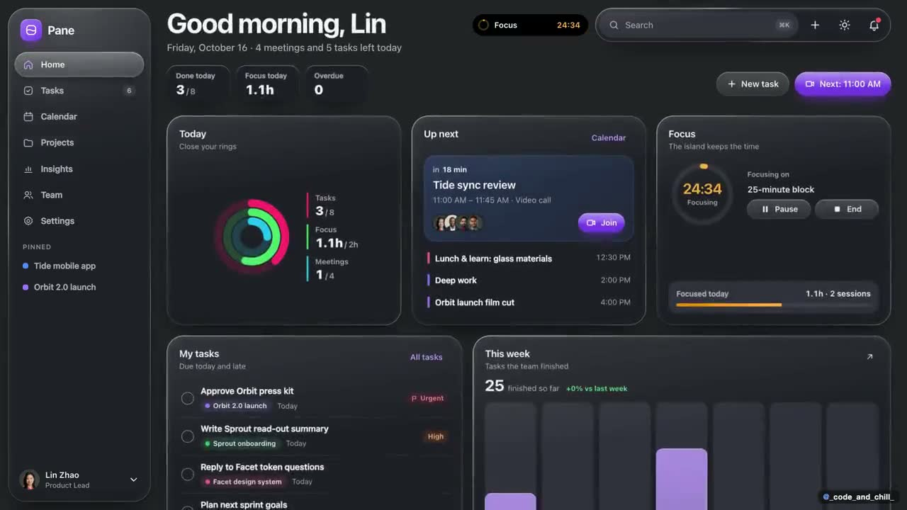
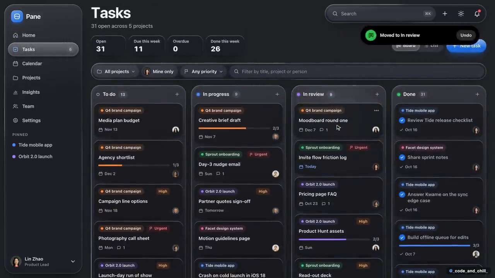
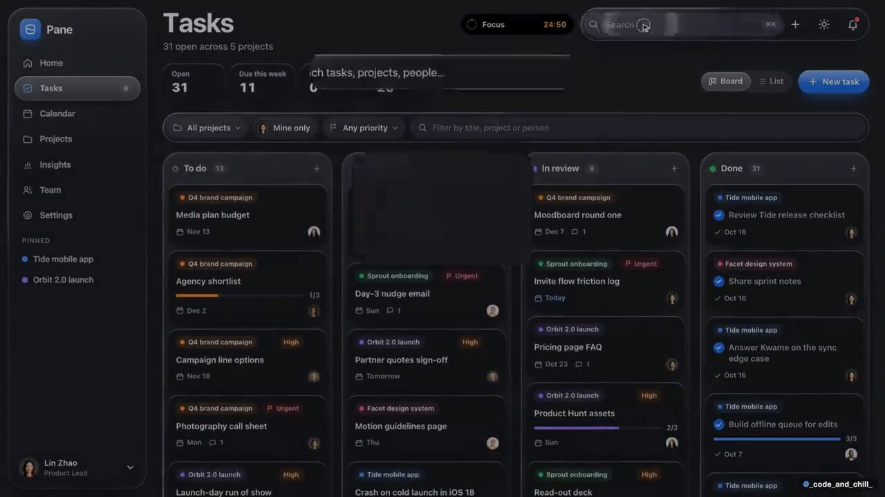
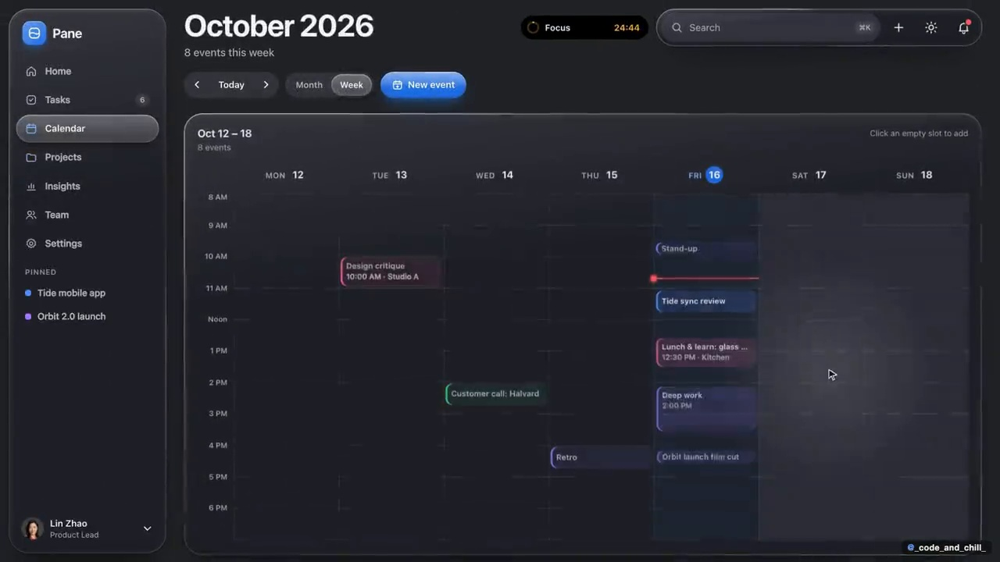
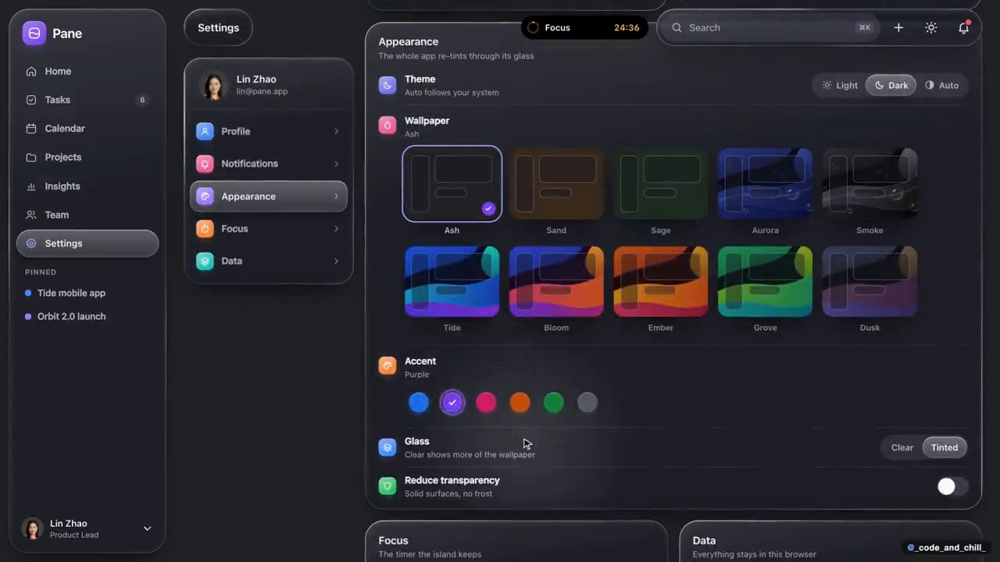
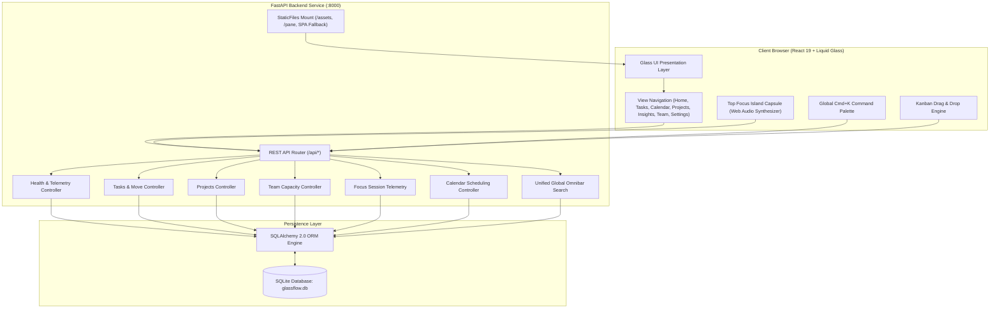

<div align="center">

# 🌌 GlassFlow (Pane)
### *Spatial Project Management & Focus Telemetry Workspace Made of Liquid Glass*

[](https://fastapi.tiangolo.com)
[](https://react.dev/)
[](https://vitejs.dev/)
[](https://tailwindcss.com/)
[](https://sqlite.org/)
[](LICENSE)

<br />



<br />
<br />

[Explore Features](#-core-capabilities) •
[Tech Stack](#-technical-stack) •
[Architecture](#-system-architecture) •
[Quick Start](#-getting-started) •
[API Reference](#-api-reference) •
[Keyboard Shortcuts](#-keyboard-shortcuts)

</div>

---

## 📖 Overview

**GlassFlow** is a modern, high-performance project management and focus telemetry workspace built for creative squads, engineering teams, and design studios. Designed around a high-fidelity **liquid glassmorphism** aesthetic, GlassFlow merges spatial task orchestration with ambient neuro-focus tools, telemetry analytics, studio calendar coordination, and instant keyboard navigation.

Available both as a **reactive full-stack React 19 application** powered by a FastAPI/SQLite backend, and with the bundled **authentic pure glass template** (`/pane/demo.html`).

---

## ✨ Core Capabilities

### 1. 🎯 Interactive Concentric Rings & Focus Dial
- **Concentric SVG Progress Rings**: Live animated tracking for daily completed tasks (pink), uninterrupted focus hours (green), and attended meetings (cyan).
- **Focus Timer Dial Capsule**: Top-docked Dynamic Island with smooth progress arcs, Pomodoro and deep work presets (15m, 25m, 50m), celestial completion chimes, and confetti celebration particle physics.
- **Synthesized Ambient Soundscapes**: Browser-native Web Audio API sound generator delivering zero-bandwidth **10Hz Alpha Waves** (binaural focus frequency), Rain Streams, and White Noise.

### 2. 📋 Liquid Kanban Task Board
- 4-column drag-and-drop workflow: `Backlog`, `In Progress`, `In Review`, and `Done`.
- Drag reordering with backend sync, priority badges (`Urgent`, `High`, `Medium`, `Low`), project tags, estimate vs. spent capacity meters, and assignee avatars.

### 3. 📅 Studio Calendar & Timeline
- Monthly calendar matrix and daily agenda stream for crits, sprint retrospectives, syncs, and delivery milestones.
- Instant event creation with category tags (`Sprint`, `Meeting`, `Milestone`, `Focus`, `Review`).

### 4. 🚀 Projects & Burndown Velocity
- Initiative roadmaps with dynamic completion bars, target delivery countdowns, milestone checkpoint trackers, and lead avatars.
- Burndown velocity curves mapping completed vs. remaining workload over time.

### 5. 👥 Team Availability & Workload Directory
- Real-time status indicators (*Online*, *In Focus*, *In Meeting*, *Away*).
- Dynamic weekly capacity load meters (`38h / 40h`), local timezone clocks, and direct contact hooks.

### 6. 🔍 Command Palette Omnibar (`⌘K` / `Ctrl+K`)
- Instant keyboard-driven global search indexing tasks, projects, teammates, and calendar events with debounced live search and quick navigation.

---

## 📸 Visual Showcase

<div align="center">

| 📋 Drag-and-Drop Kanban Board | 📅 Studio Agenda & Calendar |
|:---:|:---:|
|  |  |

| 🚀 Initiative Milestones & Burndown | 👥 Team Workload & Presence |
|:---:|:---:|
|  |  |

</div>

---

## 🛠️ Technical Stack

### **Frontend**
| Layer | Technology | Purpose |
| :--- | :--- | :--- |
| **Framework** | **React 19 (TypeScript)** | Latest React concurrency, hooks, and strict type safety |
| **Build Tool** | **Vite 8** | Instant Hot Module Replacement (HMR) and optimized Rollup bundling |
| **Styling** | **Tailwind CSS v4** | Utility-first styling with hardware-accelerated CSS glass tokens |
| **Icons** | **Lucide React** | Clean, minimalist, scalable SVG iconography |
| **Sound Synthesis** | **Web Audio API** | Client-side pure audio synthesis for binaural 10Hz alpha waves & rain |
| **FX & Animation** | **Canvas Confetti** | Smooth celebratory confetti particle bursts |

### **Backend**
| Layer | Technology | Purpose |
| :--- | :--- | :--- |
| **API Engine** | **FastAPI (Python 3.12+)** | High-throughput asynchronous ASGI web framework |
| **Application Server**| **Uvicorn** | Lightning-fast ASGI server with auto-reload |
| **ORM & Database** | **SQLAlchemy 2.0 + SQLite** | Declarative ORM with automatic schema bootstrapping and persistence |
| **Validation** | **Pydantic v2** | Strict request/response typing, serialization, and validation |
| **Deployment** | **Unified SPA Static Mount** | FastAPI serves `/api/*` and compiled SPA static assets from `frontend/dist` |

---

## 🏗️ System Architecture



---

## 📁 Repository Map

```
ProjectManagementApp-Pane/
├── backend/                  # FastAPI Backend API
│   ├── database.py           # SQLite connection & session maker
│   ├── main.py               # API routes, CORS, and SPA static mount
│   ├── models.py             # SQLAlchemy 2.0 database models
│   ├── schemas.py            # Pydantic validation schemas
│   ├── seed_data.py          # Default studio fixtures & demo dataset
│   └── requirements.txt      # Python dependencies
├── frontend/                 # React 19 Frontend Workspace
│   ├── public/               # Public assets, icons & /pane template
│   ├── src/
│   │   ├── components/       # Glassmorphic React views & UI components
│   │   │   ├── HomeView.tsx        # Rings, up next, focus dial & tasks
│   │   │   ├── KanbanBoard.tsx     # 4-column drag-and-drop board
│   │   │   ├── CalendarView.tsx    # Monthly & daily agenda view
│   │   │   ├── ProjectsView.tsx    # Roadmaps & burndown velocity
│   │   │   ├── InsightsView.tsx    # Focus telemetry & completion stats
│   │   │   ├── TeamDirectory.tsx   # Capacity meters & availability
│   │   │   ├── SettingsView.tsx    # Wallpapers, themes & soundscapes
│   │   │   ├── FocusCapsule.tsx    # Floating island focus pill
│   │   │   ├── Soundscape.ts       # HTML5 Web Audio synthesizer
│   │   │   ├── CommandPalette.tsx  # Cmd+K search modal
│   │   │   ├── TaskModal.tsx       # Task drawer & editor
│   │   │   ├── Sidebar.tsx         # Floating glass navigation sidebar
│   │   │   └── TopBar.tsx          # Studio header bar
│   │   ├── context/          # ThemeContext (Themes, Wallpapers, Island)
│   │   ├── services/         # Typed API client fetch layer (api.ts)
│   │   ├── types/            # TypeScript domain interfaces
│   │   ├── App.tsx           # Main application shell
│   │   └── index.css         # Glassmorphism tokens & Tailwind imports
│   ├── package.json          # Node dependencies & build scripts
│   └── vite.config.ts        # Vite configuration & proxy
├── docs/                     # Documentation & screenshots
│   ├── screenshots/          # Hero, Kanban, Calendar, and Project previews
│   ├── reference/            # Template reference media (video, specs)
│   └── SYSTEM_DESIGN.md      # Full architecture specifications
├── start-backend.bat         # Windows one-click backend launcher
├── start-frontend.bat        # Windows one-click frontend launcher
├── requirements.txt          # Root Python dependencies
├── LICENSE                   # Open Source MIT License
└── README.md                 # Project documentation
```

---

## 🚀 Getting Started

### Prerequisites
- **Python**: 3.11+
- **Node.js**: 18+ (Node 20+ or 24 recommended)
- **Package Manager**: `npm` (or `pnpm`)

---

### Step 1: Start Backend API

```bash
# Option A: Windows double-click start-backend.bat, or run from terminal:
.\.venv\Scripts\python.exe -m uvicorn backend.main:app --host 127.0.0.1 --port 8000 --reload
```
> The database (`glassflow.db`) is automatically created and populated with demo fixtures on initial run.
> 
> - **Backend API Root**: `http://127.0.0.1:8000`
> - **Interactive Swagger Docs**: `http://127.0.0.1:8000/docs`
> - **Redoc API Reference**: `http://127.0.0.1:8000/redoc`

---

### Step 2: Start Frontend Development Server

In a second terminal:

```bash
# Option A: Windows double-click start-frontend.bat, or run:
cd frontend
npm install
npm run dev
```

> Open **`http://localhost:5173`** in your browser. Vite proxies all `/api/*` calls directly to the FastAPI server.

---

### Step 3: Production Single-Command Build & Serve

You can compile the frontend into optimized static bundles and serve the entire full-stack app from a single FastAPI process:

```bash
# 1. Build the production React bundle
cd frontend
npm run build
cd ..

# 2. Launch FastAPI to serve both APIs and the compiled SPA
.\.venv\Scripts\python.exe -m uvicorn backend.main:app --host 127.0.0.1 --port 8000
```

Access your production app at **`http://127.0.0.1:8000`**.

---

## 🔌 API Reference

| Method | Endpoint | Description |
| :--- | :--- | :--- |
| `GET` | `/api/health` | Health status and studio metrics count |
| `GET` / `POST` | `/api/projects` | List all projects / Create new project |
| `GET` / `PATCH` | `/api/projects/{id}` | Retrieve project / Update project details |
| `DELETE` | `/api/projects/{id}` | Delete project and cascade associated tasks |
| `GET` / `POST` | `/api/tasks` | List tasks (filterable by status, project, priority) / Create task |
| `PATCH` / `DELETE`| `/api/tasks/{id}` | Update task details or status / Delete task |
| `POST` | `/api/tasks/move` | Atomic drag-and-drop batch status and order reordering |
| `GET` / `POST` | `/api/team` | Team member roster / Add team member |
| `PATCH` | `/api/team/{id}` | Update capacity hours or availability presence |
| `GET` / `POST` | `/api/focus` | Focus session logs / Record completed focus sprint |
| `GET` | `/api/focus/summary` | Today's focus minutes, completed sessions, and streak count |
| `GET` / `POST` | `/api/calendar` | List events by date range / Schedule studio event |
| `PATCH` / `DELETE`| `/api/calendar/{id}` | Update calendar event / Delete event |
| `GET` | `/api/search?q={query}` | Global search across tasks, projects, members, and events |
| `POST` | `/api/seed` | Reset and reload default studio fixtures |

---

## ⌨️ Keyboard Shortcuts

| Shortcut | Action |
| :--- | :--- |
| `⌘K` or `Ctrl+K` | Open / Close Studio Omnibar Search & Quick Actions |
| `Escape` | Dismiss Omnibar or close active modal / drawer |
| `↑` / `↓` | Navigate Omnibar search results |
| `Enter` | Select item / Execute studio action |

---

## 📄 License

This project is licensed under the [MIT License](LICENSE).
