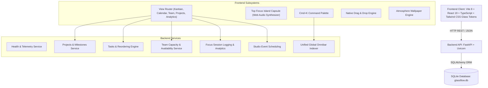
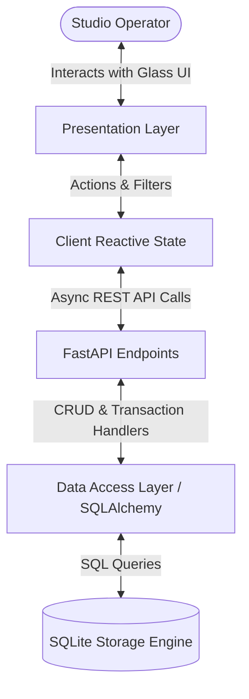
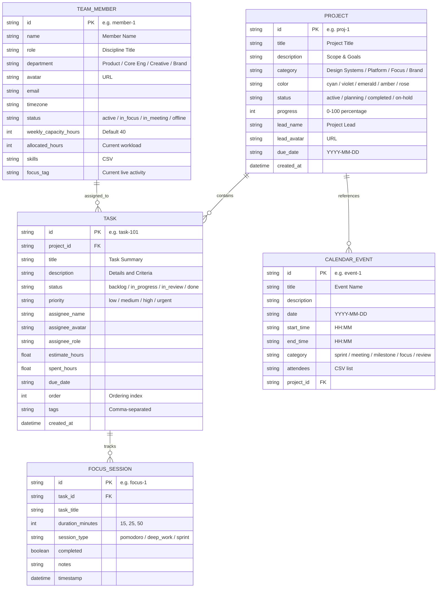

# System Design & Architecture Document: GlassFlow

## 1. Executive Summary

**GlassFlow** is a modern, production-ready, full-stack project management and focus telemetry workspace built for creative teams, engineering squads, and design studios. Built around a fluid, multi-layered liquid glass aesthetic (glassmorphism), GlassFlow integrates real-time task coordination (Kanban with drag-and-drop), spatial focus timer capsule with synthesis soundscapes, studio-wide calendar scheduling, team workload capacity tracking, and instantaneous keyboard-driven omnibar search (`⌘K`).

---

## 2. High-Level Design (HLD)

### 2.1 System Architecture Overview

The system follows a decoupled Single Page Application (SPA) and REST API architecture backed by SQLite with persistent connection pooling and automatic seed bootstrapping.

---

## 3. Low-Level Design (LLD)

### 3.1 Data Flow Diagram (DFD - Level 1)

### 3.2 Database Schema & Entity Relationship Diagram (ERD)

---

## 4. Key Subsystems & Design Decisions

### 4.1 Liquid Glassmorphic Theme Engine

- **CSS Custom Properties**: Dynamic theme switching between 5 curated atmospheric presets (`Aurora Deep`, `Cyber Twilight`, `Liquid Emerald`, `Sunset Solstice`, `Obsidian Minimal`).
- **Specular Border Highlights**: Multi-layered backdrop filters with variable blur (`blur(16px)` to `blur(20px)`), subtle translucent gradient borders (`border-white/10` to `border-white/30`), and soft radial glow illumination.
- **Micro-Interactions**: Easing cubic-bezier transitions (`cubic-bezier(0.16, 1, 0.3, 1)`) on card hovers and dock elements.

### 4.2 Floating Focus Capsule with Web Audio Synthesis

- **Zero External Audio Dependencies**: Ambient audio generates directly via the HTML5 Web Audio API:
  - _10Hz Alpha Waves_: Dual sine wave oscillators (210 Hz and 220 Hz) for binaural frequency synchrony.
  - _Rain Stream_: Pink-noise randomized buffer with dynamic bandpass filtering (1200 Hz, Q: 1.0).
  - _Warm White Noise_: Lowpass filtered (800 Hz) random noise buffer.
  - _Celestial Completion Chime_: Multi-tonal harmonic chords (C5, E5, G5, C6) triggered with exponential gain decay.
- **Progress Ring & Confetti**: SVG circular progress indicator with dashoffset interpolation and celebratory multi-colored confetti bursts upon session completion.

### 4.3 Native Drag-and-Drop Kanban Board

- Standard HTML5 Drag and Drop events (`onDragStart`, `onDragOver`, `onDragLeave`, `onDrop`) optimized for 60fps performance without heavy external library bloat.
- Column re-ordering and status mutation persist immediately via backend REST endpoints (`/api/tasks/move` and `/api/tasks/{id}`).

### 4.4 Global Omnibar (`⌘K` / `Ctrl+K`)

- Omnipresent modal search indexing projects, tasks, team members, and calendar events with client-side debounce (180ms) and keyboard arrow navigation.
- Built-in shortcuts for theme switching, focus session triggering, task creation, and database re-seeding.

---

## 5. Security & Deployment Topology

- **Unified Full-Stack Deployment**: FastAPI serves API endpoints on `/api/*` and acts as an SPA fallback static file server for `frontend/dist/`.
- **Zero-Config Development**: Dual server support with Vite dev proxy (`localhost:5173` -> `localhost:8000`) for hot-module reloading during development.
- **Data Persistence**: Local SQLite file (`glassflow.db`) with automatic table creation and idempotent seed data generation on initial boot.
